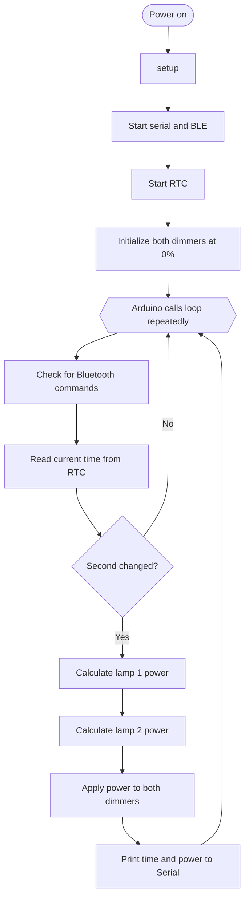
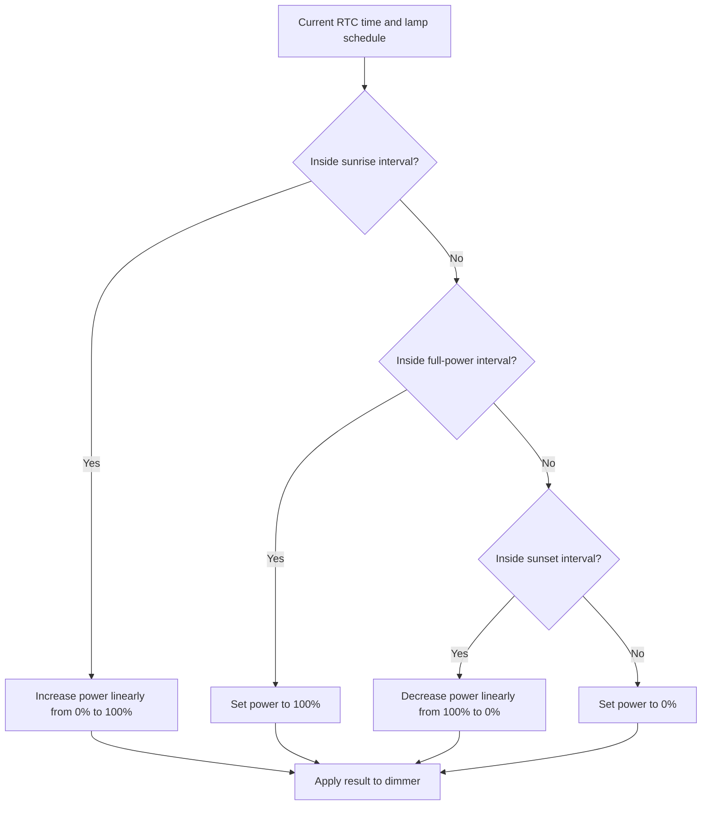
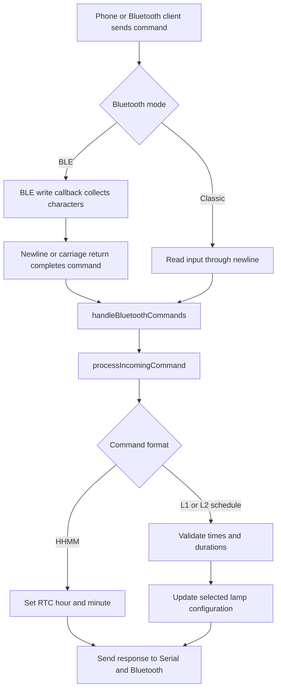

# Chicken Coop Smart Light — Software Flow

This page illustrates how the ESP32 firmware starts, updates the lamps, and
processes Bluetooth commands. The diagrams use Mermaid and render in Markdown
viewers that support Mermaid, such as GitHub and the VS Code Markdown preview.

## Overall program flow

`ChickenCoop.ino` contains the Arduino `loop()` entry point. It calls
`runChickenCoopLoop()` in `ChickenCoop.cpp`. Bluetooth is checked on each loop
iteration; lamp power is recalculated when the RTC second changes.

## How a lamp's power is calculated

The same schedule calculation is performed independently for each lamp. The
start and end points are calculated from that lamp's configuration.

Intervals that cross midnight are supported. A zero-power result turns the
dimmer off; a positive result turns it on and sets its power level.

## Bluetooth command flow

BLE is selected by default with `USE_BLE`. The alternate build path uses
Bluetooth Classic serial.

### Supported command formats

| Command | Example | Effect |
| --- | --- | --- |
| `HHMM` | `1430` | Set the RTC time to 14:30, preserving its date and setting seconds to zero. |
| `L1HHMM;SUNRISE;HHMM;SUNSET` | `L12030;15;2045;15` | Set lamp 1's full-power start, sunrise duration, ramp-down start, and sunset duration. |
| `L2HHMM;SUNRISE;HHMM;SUNSET` | `L22100;15;2115;15` | Set the same schedule fields for lamp 2. |

Times use 24-hour `HHMM` format, and durations are in minutes. Updated lamp
settings are held in memory and return to their defaults after a restart.
